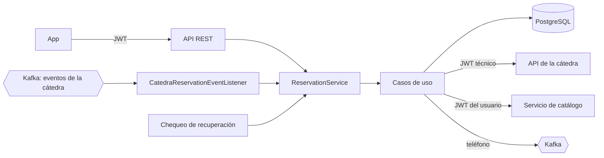
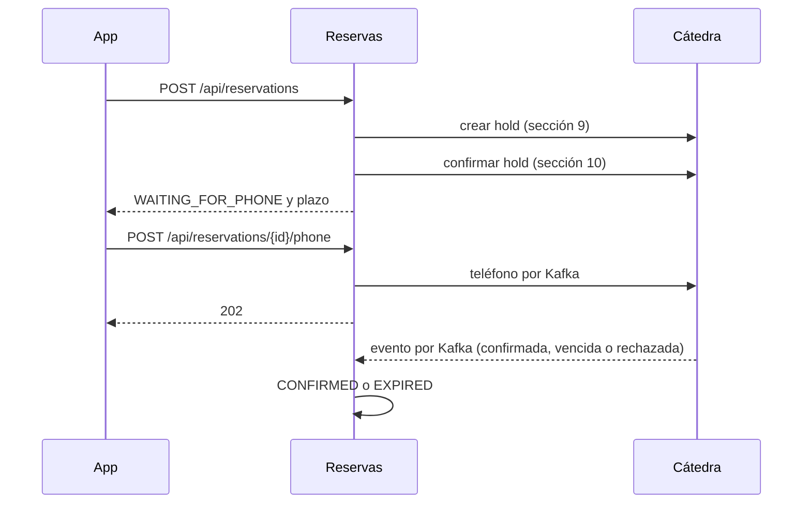

<!-- calidad:inicio -->
            

**Calidad (heurístico, 7 dimensiones):** índice **76/100** · build **OK** · aprobar **no (7/11)** · destacar **no**
Detalle completo en [`docs/EVALUACION.md`](docs/EVALUACION.md).
<!-- calidad:fin -->

# turnos-servicio-reservas

[](https://sonarcloud.io/summary/new_code?id=Prog2-IanOlmedo_turnos-servicio-reservas) [](https://sonarcloud.io/summary/new_code?id=Prog2-IanOlmedo_turnos-servicio-reservas)

Servicio de usuarios y reservas del sistema distribuido de turnos (Programación II, Universidad de Mendoza). Registra y autentica a los usuarios de la app, calcula la disponibilidad de los profesionales y gestiona cada reserva contra el servicio de la cátedra, por REST y Kafka. Caso de estudio académico con datos ficticios.

## Arquitectura

Arquitectura hexagonal por slice vertical: `reservation` (reservas) y `user` (usuarios). El dominio no depende de Spring ni de la infraestructura.

| Capa | Contenido |
|---|---|
| Dominio (`domain/model`) | `ReservationProcess` con su máquina de estados, `Availability`, `PhoneNumber`, eventos de la cátedra |
| Puertos (`domain/ports/in`, `domain/ports/out`) | Una interfaz por caso de uso. Salidas: repositorios, `AppointmentGateway` (cátedra), `ProfessionalScheduleSource` (catálogo), `PhoneSubmissionPublisher` (Kafka) |
| Aplicación (`application`) | Casos de uso y la fachada `ReservationService` |
| Infraestructura (`infrastructure`) | `web`, `persistence` (JPA), `client` (cátedra y catálogo), `messaging` (Kafka), `scheduling`, `security` |



## API

Todos los endpoints piden `Authorization: Bearer <JWT>`, salvo el registro, el login y `GET /actuator/health`. Cada usuario ve y opera solo sus reservas: una reserva ajena responde lo mismo que una inexistente (404).

| Método y ruta | Qué hace |
|---|---|
| `POST /api/register` | Registra un usuario (`login`, `password`, `firstName`, `lastName`, `email`) |
| `POST /api/authenticate` | Login (`username`, `password`, `rememberMe`). Devuelve `id_token` |
| `GET /api/account` | Datos del usuario logueado |
| `GET /api/professionals/{id}/availability?date=AAAA-MM-DD` | Turnos libres de un profesional en una fecha (`HH:mm`) |
| `POST /api/reservations` | Inicia una reserva (`professionalId`, `date`, `startTime`, `patientFirstName`, `patientLastName`) |
| `GET /api/reservations` | Reservas del usuario |
| `GET /api/reservations/{id}` | Una reserva |
| `POST /api/reservations/{id}/phone` | Envía el teléfono para completar la reserva. Responde 202 |
| `POST /api/reservations/{id}/cancel` | Cancela una reserva |

Los errores usan el formato *problem details* con un campo `code`. Cuando la cátedra rechaza un pedido, se informa su status y su código (por ejemplo, `INVALID_SLOT`).

## Flujo de una reserva



Estados: `HELD`, `WAITING_FOR_PHONE`, `CONFIRMED`, `CANCELLED`, `EXPIRED` e `INVALID`. Una vez en un estado final, el proceso no vuelve a cambiar.

**Disponibilidad.** Se toma la agenda semanal del profesional del servicio de catálogo, reenviando el JWT del usuario, y se le restan las ocupaciones que informa la cátedra para esa fecha (sección 8). Si el profesional no atiende ese día no se consulta a la cátedra. 404 si el profesional no existe; 503 si el catálogo no responde.

## Recuperación e idempotencia

- **Recuperación.** 15 segundos después de arrancar, y luego cada minuto, se buscan los procesos abiertos (`HELD` o `WAITING_FOR_PHONE`) que vencieron hace más de un minuto. Antes de cerrarlos se le pregunta a la cátedra cómo quedaron (`GET /api/appointments`, sección 11), porque un timeout no prueba que la operación haya fallado: se confirman, se vencen o se dejan para la próxima pasada. Si la cátedra no responde, no se cierra nada.
- **Eventos repetidos.** Cada evento de Kafka se registra por su `eventId` en `processed_event`. Uno repetido se ignora.
- **Transiciones.** Aplicar dos veces el mismo cambio de estado no tiene efecto, y nunca se reabre un estado final.

## Seguridad

- Contraseñas con Argon2. JWT HS512 firmado con `JWT_SECRET` (Base64, mínimo 64 bytes), que dura 1 día o 30 días con `rememberMe`. La misma clave la usa el catálogo para validar.
- Sin sesión de servidor. CSRF desactivado solo en el registro y el login.
- Con la cátedra se usa su JWT técnico (`CATEDRA_JWT`). Nunca se manda a la app ni se loguea.
- El número de teléfono no se loguea.
- Los secretos salen solo del entorno o del `.env`, que está en `.gitignore`. En el repositorio solo hay placeholders (`.env.example`).

## Modelo de datos

PostgreSQL con migraciones Flyway (`src/main/resources/db/migration`).

| Tabla | Contenido |
|---|---|
| `reservation_process` | Cada reserva: ids de la cátedra (`reservation_process_id`, `hold_id`, `reservation_id`), paciente, profesional, fecha y hora, estado, plazo (`expires_at`), motivo y pedido de teléfono |
| `processed_event` | Eventos de Kafka ya procesados, para no aplicarlos dos veces |
| `app_user` | Usuarios de la app, con la contraseña hasheada |
| `user_authority` | Roles de cada usuario |

## Configuración

```bash
cp .env.example .env
```

Completar `.env` con valores reales. No se sube al repositorio.

| Variable | Para qué |
|---|---|
| `RESERVAS_DB_NAME`, `RESERVAS_DB_USER`, `RESERVAS_DB_PASSWORD`, `RESERVAS_DB_PORT` | Base PostgreSQL propia |
| `CATEDRA_API_URL`, `CATEDRA_JWT` | API de la cátedra y su JWT técnico |
| `CATALOGO_API_URL` | Servicio de catálogo. Desde Docker, mientras corran en composes separados: `http://host.docker.internal:8081` |
| `JWT_SECRET` | Clave de los JWT de los usuarios, igual a la del catálogo |
| `KAFKA_BOOTSTRAP_SERVERS`, `KAFKA_CONSUMER_GROUP_ID` | Conexión a Kafka |
| `KAFKA_ACTIONS_TOPIC` | Eventos de la cátedra sobre las reservas |
| `KAFKA_PHONE_TOPIC` | Envío del teléfono a la cátedra |
| `CATEDRA_GROUP_ID` | Identificador de grupo asignado por la cátedra |
| `RESERVAS_APP_PORT` (opcional) | Puerto de la API en el host. Por defecto 8082 |

## Ejecución

```bash
docker compose up -d --build
```

- La API queda en el puerto 8082 del host (`RESERVAS_APP_PORT`).
- PostgreSQL solo escucha en `127.0.0.1` (`RESERVAS_DB_PORT`).
- El `.env` no se copia a la imagen: compose pasa los valores como variables de entorno.
- Para integrarse con la cátedra hace falta estar conectado a su red (ZeroTier). Para la disponibilidad, el catálogo tiene que estar levantado.

## Pruebas

```bash
./mvnw verify
```

Requiere Docker: las pruebas de persistencia levantan PostgreSQL con Testcontainers. La cátedra y el catálogo se simulan (`MockRestServiceServer`), y en las pruebas se apagan el listener de Kafka y el chequeo de recuperación. El CI corre el mismo comando y publica el análisis en SonarCloud.
