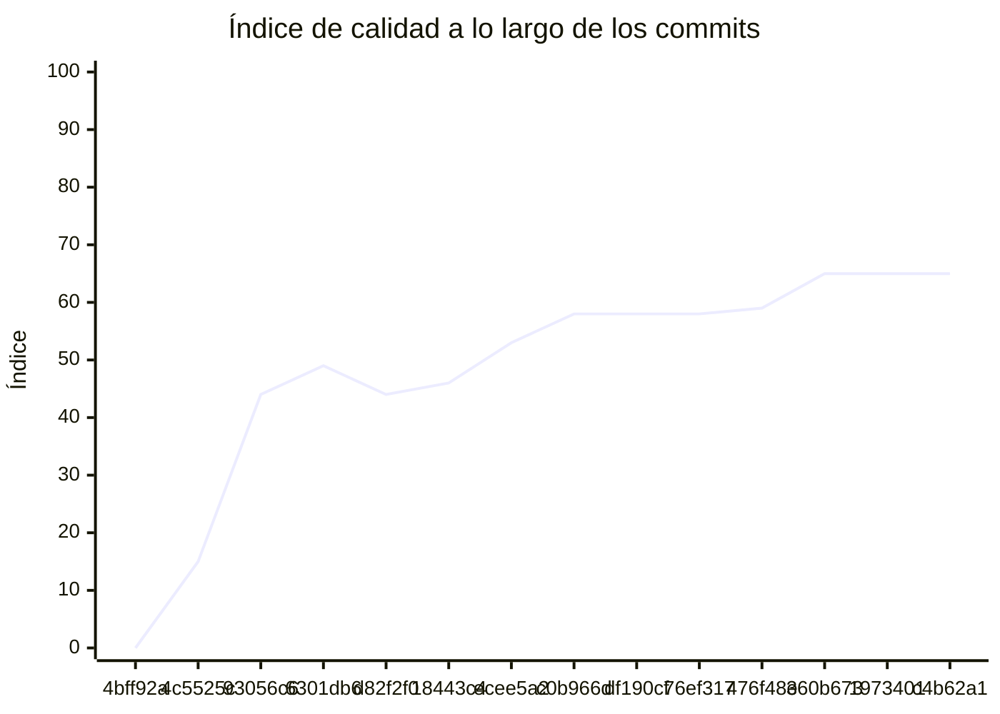

<!-- evaluacion:inicio -->
# Evaluación — Prog2-IanOlmedo/turnos-servicio-reservas

> Documento **generado automáticamente** por la cátedra de Programación II (UM): RepoSense + análisis de calidad de **7 dimensiones**. **No editar a mano**: se regenera en cada evaluación.
> Rama evaluada: `main`. Análisis **heurístico** (regex + métricas) + build: es una criba para orientar la revisión, **no una nota**. La **documentación** del repositorio no se evalúa.
> Generado: 2026-11-11.

## 1. Veredicto

| Aspecto | Resultado |
|---|---|
| Índice de calidad | **76/100** |
| Tipo de repositorio | `backend` |
| Build (`mvnw verify` / `gradlew check`) | OK |
| Código (LOC) | 4,521 |
| Archivos de código | 138 |
| Clases | 139 |
| Código dentro de clases (%POO) | 70% |
| Funciones fuera de clases | 0 |
| Duplicación (puerta) | 0.0% |
| Duplicación lógica | 0.0% |
| Duplicación de boilerplate | 3.8% |
| Cobertura | 97% |
| Tope duro aplicado a D1 | `POO_BAJO` → D1 ≤ 60 |

> Este informe **describe** lo que el análisis midió con los criterios ya establecidos de la materia. No es una nota.

## 2. Semáforo de aprobación

Criterios de la cátedra (`CRITERIOS-CALIDAD.md`): **Aprobar** se juega con el perfil `estandar`; **destacar**, con el `exigente` (meta de excelencia).

| Semáforo | Resultado |
|---|---|
| Aprobar (`estandar`) | **no cumple** — 7/11 |
| Destacar (`exigente`) | **no cumple** — 6/11 |

**Para aprobar, falta cumplir:** SOLID

**Para destacar, falta cumplir:** SOLID; POO

## 3. Autoría (RepoSense)

| Autor | Commits | Código (LOC) | Tests (LOC) | Docs (LOC) | Días activos | % del código |
|---|---:|---:|---:|---:|---:|---:|
| IanOlmedo | 41 | 2,745 | 2,738 | 12 | 14 | 100% |

> _El LOC de autoría lo calcula RepoSense sobre el historial y puede diferir del LOC de código del análisis (que mira el estado de `main`)._

## 4. Dimensiones evaluadas

Cada dimensión indica **qué mide**, **por qué importa** y **tu resultado**. Cuando el puntaje queda por debajo de la referencia, se agregan preguntas para **investigar la causa** (no hay recetas).

| Dimensión | Peso | Puntaje |
|:--|--:|--:|
| **D1** Diseño OO, SOLID y patrones (20%) | 20% | 3 |
| **D2** Arquitectura hexagonal — backend (15%) | 15% | 100 |
| **D3** Frontend KMP: MVVM y buenas prácticas (10%) | 10% | N/A |
| **D4** Integración y contrato (10%) | 10% | 80 |
| **D5** Seguridad y robustez (10%) | 10% | 100 |
| **D6** Pruebas y cobertura (20%) | 20% | 100 |
| **D7** Proceso y entrega (15%) | 15% | 100 |

### D1. Diseño OO, SOLID y patrones (20%)

- **Qué mide:** Métricas orientadas a objetos (clases, métodos, campos, cohesión, acoplamiento, herencia) y proxies de SOLID, más patrones de diseño.
- **Por qué importa:** El eje de la materia es el buen uso de la POO y su arquitectura: un diseño con clases claras y poco acopladas es más fácil de entender, probar y cambiar.
- **Tu resultado:** **3/100**
- **Para investigar la causa:**
    - ¿Se pensó el modelo de clases antes de codificar o se agrupó después?
    - ¿Qué clases concentran muchas responsabilidades a la vez?
    - ¿Los colaboradores llegan como parámetros o se crean por dentro?

### D2. Arquitectura hexagonal — backend (15%)

- **Qué mide:** Separación en capas (dominio, puertos de entrada/salida, adaptadores) y dirección de las dependencias del backend.
- **Por qué importa:** Aislar el dominio de la infraestructura permite cambiar la base de datos, el framework o el transporte sin tocar las reglas de negocio.
- **Tu resultado:** **100/100**

### D4. Integración y contrato (10%)

- **Qué mide:** Cumplimiento del contrato de integración de la cátedra (formato de errores, paginación, autenticación, endpoints esperados).
- **Por qué importa:** Los servicios deben poder integrarse entre sí y con la app sin sorpresas; el contrato es lo que hacen cumplir las pruebas de integración.
- **Tu resultado:** **80/100**

### D5. Seguridad y robustez (10%)

- **Qué mide:** Credenciales embebidas, consultas SQL por concatenación, y presencia de config de entorno; aislamiento de secretos.
- **Por qué importa:** Un secreto en el repositorio o una consulta construida por concatenación son riesgos concretos, no hipotéticos.
- **Tu resultado:** **100/100**

### D6. Pruebas y cobertura (20%)

- **Qué mide:** Cantidad y resultado de pruebas y cobertura de línea (JaCoCo/Kover, Surefire/Failsafe) cuando hay build.
- **Por qué importa:** Las pruebas son la red de seguridad para refactorizar e integrar; la cobertura acota las zonas sin verificar.
- **Tu resultado:** **100/100**

### D7. Proceso y entrega (15%)

- **Qué mide:** Artefactos verificables de proceso/entrega: `compose`, `.env.example`, CI (`.github/workflows/`), `CODEOWNERS` y wrapper de build (`mvnw`/`gradlew`). **No** puntúa documentación.
- **Por qué importa:** Un proyecto que compila, se levanta y se valida solo es más fácil de revisar y de integrar en equipo.
- **Tu resultado:** **100/100**

## 5. Señales detectadas

El análisis encontró las siguientes señales (archivo, sin número de línea a propósito):

**SRP/responsabilidad** (29)
- clase 'ReservationProcessEntity' grande (LOC=18, métodos=0, campos=12) — `src/main/java/com/turnos/reservas/reservation/infrastructure/persistence/entity/ReservationProcessEntity.java`
- clase 'ReservationProcessEntity' sin métodos (12 campos): solo datos — `src/main/java/com/turnos/reservas/reservation/infrastructure/persistence/entity/ReservationProcessEntity.java`
- clase 'CatedraAppointmentClient' con baja cohesión (29%) — `src/main/java/com/turnos/reservas/reservation/infrastructure/client/CatedraAppointmentClient.java`
- clase 'ReservationResponse' grande (LOC=13, métodos=0, campos=10) — `src/main/java/com/turnos/reservas/reservation/infrastructure/web/dto/ReservationResponse.java`
- clase 'ReservationResponse' sin métodos (10 campos): solo datos — `src/main/java/com/turnos/reservas/reservation/infrastructure/web/dto/ReservationResponse.java`
- clase 'StartReservationRequest' sin métodos (5 campos): solo datos — `src/main/java/com/turnos/reservas/reservation/infrastructure/web/dto/StartReservationRequest.java`
- clase 'ReservationService' con baja cohesión (4%) — `src/main/java/com/turnos/reservas/reservation/application/service/ReservationService.java`
- clase 'ReservationProcess' grande (LOC=134, métodos=17, campos=12) — `src/main/java/com/turnos/reservas/reservation/domain/model/ReservationProcess.java`
- clase 'ReservationProcess' con baja cohesión (24%) — `src/main/java/com/turnos/reservas/reservation/domain/model/ReservationProcess.java`
- método 'ReservationProcess.reconcileWith' con complejidad 6 — `src/main/java/com/turnos/reservas/reservation/domain/model/ReservationProcess.java`
- método 'ReservationEvent.applyTo' con complejidad 7 — `src/main/java/com/turnos/reservas/reservation/domain/model/ReservationEvent.java`
- clase 'UserEntity' grande (LOC=28, métodos=0, campos=11) — `src/main/java/com/turnos/reservas/user/infrastructure/persistence/entity/UserEntity.java`
- clase 'UserEntity' sin métodos (11 campos): solo datos — `src/main/java/com/turnos/reservas/user/infrastructure/persistence/entity/UserEntity.java`
- clase 'AccountResponse' grande (LOC=12, métodos=0, campos=10) — `src/main/java/com/turnos/reservas/user/infrastructure/web/dto/AccountResponse.java`
- clase 'AccountResponse' sin métodos (10 campos): solo datos — `src/main/java/com/turnos/reservas/user/infrastructure/web/dto/AccountResponse.java`
- clase 'LoginRequest' sin métodos (3 campos): solo datos — `src/main/java/com/turnos/reservas/user/infrastructure/web/dto/LoginRequest.java`
- clase 'RegisterRequest' sin métodos (7 campos): solo datos — `src/main/java/com/turnos/reservas/user/infrastructure/web/dto/RegisterRequest.java`
- clase 'User' grande (LOC=31, métodos=1, campos=12) — `src/main/java/com/turnos/reservas/user/domain/model/User.java`
- clase 'SecurityIntegrationTests' grande (LOC=66, métodos=10, campos=2) — `src/test/java/com/turnos/reservas/SecurityIntegrationTests.java`
- clase 'CatedraAppointmentClientTest' grande (LOC=146, métodos=29, campos=5) — `src/test/java/com/turnos/reservas/reservation/infrastructure/client/CatedraAppointmentClientTest.java`
- clase 'CatedraAppointmentClientTest' con baja cohesión (33%) — `src/test/java/com/turnos/reservas/reservation/infrastructure/client/CatedraAppointmentClientTest.java`
- clase 'ReservationCommandsControllerTest' grande (LOC=130, métodos=16, campos=5) — `src/test/java/com/turnos/reservas/reservation/infrastructure/web/controller/ReservationCommandsControllerTest.java`
- clase 'ReservationServiceTest' grande (LOC=73, métodos=9, campos=8) — `src/test/java/com/turnos/reservas/reservation/application/service/ReservationServiceTest.java`
- clase 'ReconcileOverdueProcessesUseCaseImplTest' con baja cohesión (29%) — `src/test/java/com/turnos/reservas/reservation/application/usecases/ReconcileOverdueProcessesUseCaseImplTest.java`
- clase 'StartReservationUseCaseImplTest' grande (LOC=83, métodos=7, campos=9) — `src/test/java/com/turnos/reservas/reservation/application/usecases/StartReservationUseCaseImplTest.java`
- clase 'ReservationReconcileTest' grande (LOC=64, métodos=11, campos=3) — `src/test/java/com/turnos/reservas/reservation/domain/model/ReservationReconcileTest.java`
- clase 'ReservationReconcileTest' con baja cohesión (27%) — `src/test/java/com/turnos/reservas/reservation/domain/model/ReservationReconcileTest.java`
- clase 'ReservationPhoneTest' grande (LOC=80, métodos=12, campos=1) — `src/test/java/com/turnos/reservas/reservation/domain/model/ReservationPhoneTest.java`
- clase 'AccountControllerTest' grande (LOC=93, métodos=10, campos=4) — `src/test/java/com/turnos/reservas/user/infrastructure/web/controller/AccountControllerTest.java`

**DIP/concretos** (62)
- clase 'ReservationProcessEntity' muy acoplada (CBO=8) — `src/main/java/com/turnos/reservas/reservation/infrastructure/persistence/entity/ReservationProcessEntity.java`
- clase 'CatedraReservationEventListener' muy acoplada (CBO=8) — `src/main/java/com/turnos/reservas/reservation/infrastructure/messaging/CatedraReservationEventListener.java`
- clase 'KafkaPhoneSubmissionPublisher' muy acoplada (CBO=17) — `src/main/java/com/turnos/reservas/reservation/infrastructure/messaging/KafkaPhoneSubmissionPublisher.java`
- clase 'KafkaPhoneSubmissionPublisher' instancia 3 concretos (CBO=17) — `src/main/java/com/turnos/reservas/reservation/infrastructure/messaging/KafkaPhoneSubmissionPublisher.java`
- clase 'CatedraAppointmentClient' muy acoplada (CBO=33) — `src/main/java/com/turnos/reservas/reservation/infrastructure/client/CatedraAppointmentClient.java`
- clase 'CatedraAppointmentClient' instancia 6 concretos (CBO=33) — `src/main/java/com/turnos/reservas/reservation/infrastructure/client/CatedraAppointmentClient.java`
- clase 'CatedraAppointmentMapper' muy acoplada (CBO=11) — `src/main/java/com/turnos/reservas/reservation/infrastructure/client/mapper/CatedraAppointmentMapper.java`
- clase 'CatedraAppointmentMapper' instancia 3 concretos (CBO=11) — `src/main/java/com/turnos/reservas/reservation/infrastructure/client/mapper/CatedraAppointmentMapper.java`
- clase 'ReservationController' muy acoplada (CBO=11) — `src/main/java/com/turnos/reservas/reservation/infrastructure/web/controller/ReservationController.java`
- clase 'ReservationExceptionHandler' muy acoplada (CBO=27) — `src/main/java/com/turnos/reservas/reservation/infrastructure/web/controller/ReservationExceptionHandler.java`
- clase 'ReservationService' muy acoplada (CBO=14) — `src/main/java/com/turnos/reservas/reservation/application/service/ReservationService.java`
- clase 'StartReservationUseCaseImpl' muy acoplada (CBO=12) — `src/main/java/com/turnos/reservas/reservation/application/usecases/StartReservationUseCaseImpl.java`
- clase 'SubmitPhoneUseCaseImpl' muy acoplada (CBO=13) — `src/main/java/com/turnos/reservas/reservation/application/usecases/SubmitPhoneUseCaseImpl.java`
- clase 'SubmitPhoneUseCaseImpl' instancia 3 concretos (CBO=13) — `src/main/java/com/turnos/reservas/reservation/application/usecases/SubmitPhoneUseCaseImpl.java`
- clase 'ReconcileOverdueProcessesUseCaseImpl' muy acoplada (CBO=9) — `src/main/java/com/turnos/reservas/reservation/application/usecases/ReconcileOverdueProcessesUseCaseImpl.java`
- clase 'AppointmentGateway' muy acoplada (CBO=8) — `src/main/java/com/turnos/reservas/reservation/domain/ports/out/AppointmentGateway.java`
- clase 'ReservationProcess' muy acoplada (CBO=29) — `src/main/java/com/turnos/reservas/reservation/domain/model/ReservationProcess.java`
- clase 'ReservationEventType' muy acoplada (CBO=13) — `src/main/java/com/turnos/reservas/reservation/domain/model/ReservationEventType.java`
- clase 'ReservationEvent' muy acoplada (CBO=12) — `src/main/java/com/turnos/reservas/reservation/domain/model/ReservationEvent.java`
- clase 'GlobalExceptionHandler' muy acoplada (CBO=14) — `src/main/java/com/turnos/reservas/shared/web/GlobalExceptionHandler.java`
- clase 'JwtConfig' muy acoplada (CBO=18) — `src/main/java/com/turnos/reservas/user/infrastructure/security/JwtConfig.java`
- clase 'JwtConfig' instancia 5 concretos (CBO=18) — `src/main/java/com/turnos/reservas/user/infrastructure/security/JwtConfig.java`
- clase 'JwtTokenIssuer' muy acoplada (CBO=10) — `src/main/java/com/turnos/reservas/user/infrastructure/security/JwtTokenIssuer.java`
- clase 'SecurityConfig' muy acoplada (CBO=33) — `src/main/java/com/turnos/reservas/user/infrastructure/security/SecurityConfig.java`
- clase 'SecurityConfig' instancia 4 concretos (CBO=33) — `src/main/java/com/turnos/reservas/user/infrastructure/security/SecurityConfig.java`
- clase 'AccountController' muy acoplada (CBO=17) — `src/main/java/com/turnos/reservas/user/infrastructure/web/controller/AccountController.java`
- clase 'UserExceptionHandler' muy acoplada (CBO=15) — `src/main/java/com/turnos/reservas/user/infrastructure/web/controller/UserExceptionHandler.java`
- clase 'RegisterUserUseCaseImpl' muy acoplada (CBO=9) — `src/main/java/com/turnos/reservas/user/application/usecases/RegisterUserUseCaseImpl.java`
- clase 'AuthenticateUserUseCaseImpl' muy acoplada (CBO=9) — `src/main/java/com/turnos/reservas/user/application/usecases/AuthenticateUserUseCaseImpl.java`
- clase 'OpenProcessesPersistenceTests' muy acoplada (CBO=10) — `src/test/java/com/turnos/reservas/OpenProcessesPersistenceTests.java`
- clase 'SecurityIntegrationTests' muy acoplada (CBO=20) — `src/test/java/com/turnos/reservas/SecurityIntegrationTests.java`
- clase 'SecurityIntegrationTests' instancia 4 concretos (CBO=20) — `src/test/java/com/turnos/reservas/SecurityIntegrationTests.java`
- clase 'ReservationPersistenceTests' muy acoplada (CBO=9) — `src/test/java/com/turnos/reservas/ReservationPersistenceTests.java`
- clase 'UserPersistenceTests' muy acoplada (CBO=9) — `src/test/java/com/turnos/reservas/UserPersistenceTests.java`
- clase 'CatedraReservationEventListenerTest' muy acoplada (CBO=15) — `src/test/java/com/turnos/reservas/reservation/infrastructure/messaging/CatedraReservationEventListenerTest.java`
- clase 'KafkaPhoneSubmissionPublisherTest' muy acoplada (CBO=15) — `src/test/java/com/turnos/reservas/reservation/infrastructure/messaging/KafkaPhoneSubmissionPublisherTest.java`
- clase 'KafkaPhoneSubmissionPublisherTest' instancia 4 concretos (CBO=15) — `src/test/java/com/turnos/reservas/reservation/infrastructure/messaging/KafkaPhoneSubmissionPublisherTest.java`
- clase 'CatedraAppointmentClientTest' muy acoplada (CBO=40) — `src/test/java/com/turnos/reservas/reservation/infrastructure/client/CatedraAppointmentClientTest.java`
- clase 'CatedraAppointmentClientTest' instancia 4 concretos (CBO=40) — `src/test/java/com/turnos/reservas/reservation/infrastructure/client/CatedraAppointmentClientTest.java`
- clase 'ReservationCommandsControllerTest' muy acoplada (CBO=35) — `src/test/java/com/turnos/reservas/reservation/infrastructure/web/controller/ReservationCommandsControllerTest.java`
- clase 'ReservationCommandsControllerTest' instancia 12 concretos (CBO=35) — `src/test/java/com/turnos/reservas/reservation/infrastructure/web/controller/ReservationCommandsControllerTest.java`
- clase 'ReservationControllerTest' muy acoplada (CBO=19) — `src/test/java/com/turnos/reservas/reservation/infrastructure/web/controller/ReservationControllerTest.java`
- clase 'ReservationControllerTest' instancia 6 concretos (CBO=19) — `src/test/java/com/turnos/reservas/reservation/infrastructure/web/controller/ReservationControllerTest.java`
- clase 'ReservationServiceTest' muy acoplada (CBO=13) — `src/test/java/com/turnos/reservas/reservation/application/service/ReservationServiceTest.java`
- clase 'CancelReservationUseCaseImplTest' muy acoplada (CBO=11) — `src/test/java/com/turnos/reservas/reservation/application/usecases/CancelReservationUseCaseImplTest.java`
- clase 'ApplyReservationEventUseCaseImplTest' muy acoplada (CBO=11) — `src/test/java/com/turnos/reservas/reservation/application/usecases/ApplyReservationEventUseCaseImplTest.java`
- clase 'ReconcileOverdueProcessesUseCaseImplTest' muy acoplada (CBO=15) — `src/test/java/com/turnos/reservas/reservation/application/usecases/ReconcileOverdueProcessesUseCaseImplTest.java`
- clase 'ReconcileOverdueProcessesUseCaseImplTest' instancia 4 concretos (CBO=15) — `src/test/java/com/turnos/reservas/reservation/application/usecases/ReconcileOverdueProcessesUseCaseImplTest.java`
- clase 'SubmitPhoneUseCaseImplTest' muy acoplada (CBO=11) — `src/test/java/com/turnos/reservas/reservation/application/usecases/SubmitPhoneUseCaseImplTest.java`
- clase 'StartReservationUseCaseImplTest' muy acoplada (CBO=21) — `src/test/java/com/turnos/reservas/reservation/application/usecases/StartReservationUseCaseImplTest.java`
- clase 'StartReservationUseCaseImplTest' instancia 6 concretos (CBO=21) — `src/test/java/com/turnos/reservas/reservation/application/usecases/StartReservationUseCaseImplTest.java`
- clase 'ReservationReconcileTest' muy acoplada (CBO=15) — `src/test/java/com/turnos/reservas/reservation/domain/model/ReservationReconcileTest.java`
- clase 'ReservationPhoneTest' muy acoplada (CBO=11) — `src/test/java/com/turnos/reservas/reservation/domain/model/ReservationPhoneTest.java`
- clase 'ReservationEventTest' muy acoplada (CBO=21) — `src/test/java/com/turnos/reservas/reservation/domain/model/ReservationEventTest.java`
- clase 'ReservationProcessTest' muy acoplada (CBO=10) — `src/test/java/com/turnos/reservas/reservation/domain/model/ReservationProcessTest.java`
- clase 'JwtTokenIssuerTest' muy acoplada (CBO=14) — `src/test/java/com/turnos/reservas/user/infrastructure/security/JwtTokenIssuerTest.java`
- clase 'AccountControllerTest' muy acoplada (CBO=26) — `src/test/java/com/turnos/reservas/user/infrastructure/web/controller/AccountControllerTest.java`
- clase 'AccountControllerTest' instancia 8 concretos (CBO=26) — `src/test/java/com/turnos/reservas/user/infrastructure/web/controller/AccountControllerTest.java`
- clase 'AuthenticateUserUseCaseImplTest' muy acoplada (CBO=8) — `src/test/java/com/turnos/reservas/user/application/usecases/AuthenticateUserUseCaseImplTest.java`
- clase 'RegisterUserUseCaseImplTest' muy acoplada (CBO=9) — `src/test/java/com/turnos/reservas/user/application/usecases/RegisterUserUseCaseImplTest.java`
- clase 'UserTest' muy acoplada (CBO=8) — `src/test/java/com/turnos/reservas/user/domain/model/UserTest.java`
- clase 'UserTest' instancia 4 concretos (CBO=8) — `src/test/java/com/turnos/reservas/user/domain/model/UserTest.java`

**OCP/type-switch** (1)
- clase 'GlobalExceptionHandler' con 1 type-checks — `src/main/java/com/turnos/reservas/shared/web/GlobalExceptionHandler.java`

## 6. Evolución por commit

Métricas calculadas sobre el estado de `main` en **cada commit** (14 commits con trabajo), del primero al último. La calidad usa el perfil `exigente`; el aporte de código lo mide RepoSense. El índice puede **bajar** al crecer el proyecto: se acumulan señales.

| # | Fecha | Commit | Autor | LOC | Índice | %POO | Duplic. | Sueltas |
|---|---|---|---|---:|---:|---:|---:|---:|
| 1 | 2026-09-05 | `4bff92a` | IanOlmedo | 0 | 0 | 0% | 0.0% | 0 |
| 2 | 2026-09-10 | `4c5525c` | Ing. Daniel Quinteros | 0 | 15 | 0% | 0.0% | 0 |
| 3 | 2026-10-13 | `93056c6` | IanOlmedo | 41 | 44 | 54% | 0.0% | 0 |
| 4 | 2026-10-17 | `6301db6` | Ing. Daniel Quinteros | 41 | 49 | 54% | 0.0% | 0 |
| 5 | 2026-10-22 | `d82f2f0` | IanOlmedo | 199 | 44 | 82% | 0.0% | 0 |
| 6 | 2026-10-24 | `18443c4` | IanOlmedo | 371 | 46 | 75% | 0.0% | 0 |
| 7 | 2026-10-24 | `ecee5a2` | IanOlmedo | 656 | 53 | 73% | 0.0% | 0 |
| 8 | 2026-10-30 | `c0b966d` | IanOlmedo | 1,116 | 58 | 69% | 2.6% | 0 |
| 9 | 2026-11-02 | `df190cf` | IanOlmedo | 1,116 | 58 | 69% | 2.6% | 0 |
| 10 | 2026-11-02 | `76ef317` | IanOlmedo | 1,544 | 58 | 68% | 1.9% | 0 |
| 11 | 2026-11-04 | `476f48e` | IanOlmedo | 2,094 | 59 | 69% | 1.4% | 0 |
| 12 | 2026-11-05 | `360b673` | IanOlmedo | 3,334 | 65 | 68% | 0.9% | 0 |
| 13 | 2026-11-10 | `1973401` | IanOlmedo | 4,056 | 65 | 70% | 0.0% | 0 |
| 14 | 2026-11-11 | `c4b62a1` | IanOlmedo | 4,521 | 65 | 70% | 0.0% | 0 |

---
_Informe generado por la cátedra. Las dimensiones y umbrales corresponden a `calidad.py` (perfil `exigente`); el semáforo, a `CRITERIOS-CALIDAD.md`. La documentación del repositorio no se evalúa. Ante dudas, revisá el archivo señalado._
<!-- evaluacion:fin -->
